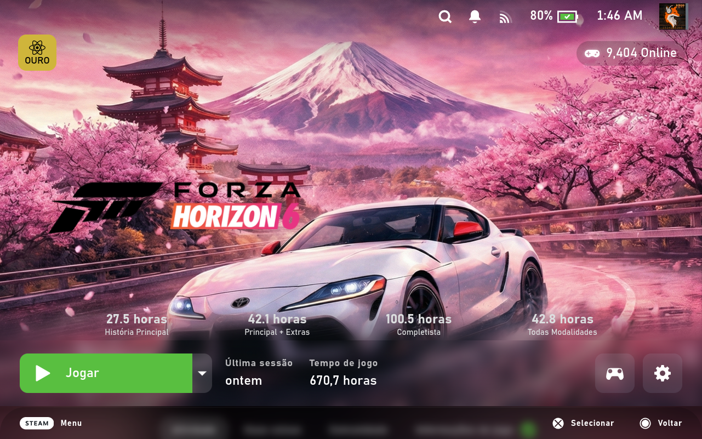
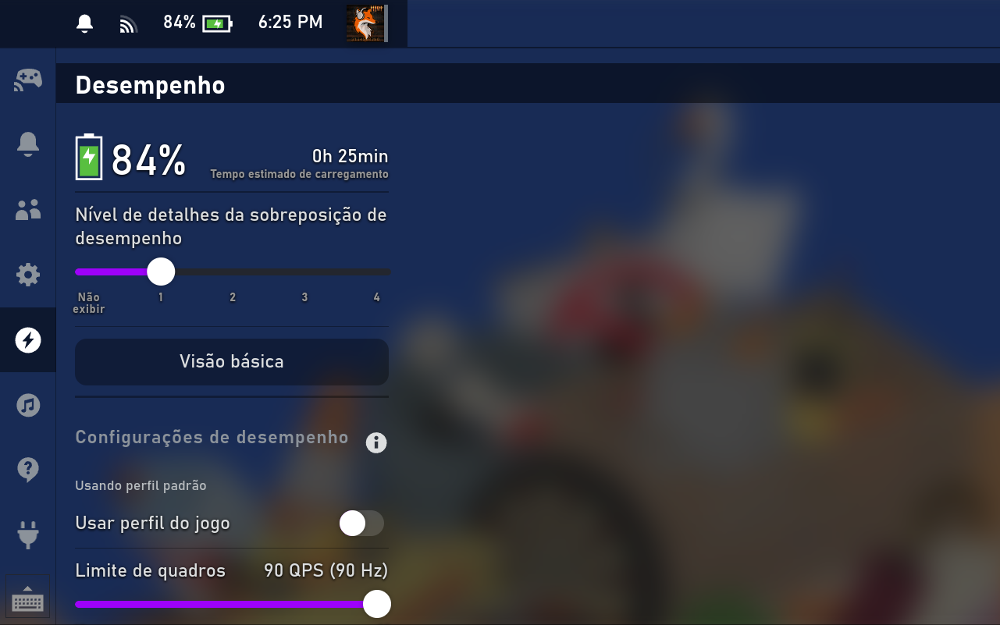

# Kitsune Midnight Glass

A [CSS Loader](https://github.com/DeckThemes/SDH-CssLoader) theme for the Steam Deck
(Game Mode / Big Picture) that turns the UI black while **keeping Steam's blur and
transparency**. It also bundles a cleaner game page, so you don't need several
separate gameview themes.

*Quick Access over a running game, with the purple accent and the game blurred behind it by the Midnight Glass Overlay plugin.*

## Features

- **Black UI, still glassy**: menus, Quick Access, Steam menu, context menus,
  library, settings, downloads and notifications go black (or any color you pick),
  with an adjustable opacity so the blur behind them can still show through.
- **Accent color**: replace Steam's blue (focus bars, progress bars, toggles,
  sliders, primary buttons) with purple, pink, gold... or any color.
- **In-game overlay**: the Steam menu, Quick Access, top bar and footer stay
  translucent over a running game instead of turning solid black, with dark
  translucent selections, readable text and no blue-gray shadows.
- **Dialogs and chat**: confirmation/warning dialogs and the chat window get
  their own opacity, with a black border.
- **Text shadow** to keep menus readable over bright games.
- **Darker game page**: the area below the play bar (friends, activity, news)
  gets a black base with the game artwork faintly showing behind it, and the
  blue-gray cards become neutral.
- **Play bar + HowLongToBeat as one panel**: Transparent, Blur, Gradient,
  Gradient + Blur or Clear, with shared opacity and tint.
- **Game logo control**: keep the logo above the HLTB bar, lift it, resize it.
- **Clean Gameview layout** with hero alignment, zoom and blur options built in.
- **Plugin touches**: adjustable opacity for the "players online" badge
  (PlayCount) and border style for the ProtonDB Badges indicator.
- Fixes a Clean Gameview issue where dragging the page by its background
  scrolled past the tabs and left the content cut off.

## Install

1. Download `Kitsune-Midnight-Glass-vX.Y.zip` (or `.rar`) from the
   [latest release](https://github.com/K1tsune12/decky-kitsune-midnight-glass-theme/releases/latest).
2. In Desktop Mode, extract it into `~/homebrew/themes/`, so you end up with
   `~/homebrew/themes/Kitsune Midnight Glass/theme.json`.
3. Back in Game Mode, open CSS Loader, refresh the theme list and enable
   **Kitsune Midnight Glass**.

For a real blur of the game behind the Steam menus, pair it with the
[**Midnight Glass Overlay**](https://github.com/K1tsune12/decky-midnight-glass-overlay)
Decky plugin, which also lets you change these options and save presets from
the Quick Access Menu.

Disable **Clean Gameview**, **Clean Gameview - Custom Zoom & Blur**,
**Blur Gameview Background** and **Obsidian** while using this theme, since it
already includes what they do.

## Options

| Option | What it does |
|---|---|
| Main Color | Base color of the UI (Black by default, presets or a custom color) |
| Accent Color | Replaces Steam's blue accent (Purple by default, presets or a custom color) |
| Menu Opacity | Opacity of menus, Quick Access and popups (100% = solid) |
| Dialog Opacity | Opacity of confirmation and warning dialogs |
| Chat Opacity | Opacity of the chat window |
| Selection Opacity | Darkness of the selected item in the Steam menu, Quick Access and chat |
| Notification Opacity | Opacity of notification toasts |
| Overlay Glass | Translucent Steam menu and Quick Access over games: dark selections, readable text, no solid grays |
| In-Game Menu Style | Theme look for the Steam menu while a game is running |
| In-Game Dim | Extra dim behind menus while a game is running (Steam keeps the original glass) |
| In-Game Bars Follow Menus | Top bar and footer use the menu color and opacity while a game is running |
| Text Shadow | Soft shadow behind text, for bright games |
| Gameview Darkness | How dark the game page is below the play bar (Original keeps Steam's look) |
| Online Badge Opacity | Background opacity of the PlayCount "online" badge |
| Play Bar Style | Transparent, Blur, Gradient, Gradient + Blur or Clear, for the play bar and HLTB bar |
| Play Bar Opacity | Strength of the play bar / HLTB background |
| Play Bar Tint | Steam's original tint or the theme's main color |
| Connect Hero with Body | Lets the hero image continue behind the play bar area |
| Hero Alignment | Zoom-Center, Zoom-Left, Zoom-Right, Contain, Stretch or Custom Zoom & Blur |
| Official / Custom Hero Zoom | Zoom for official and custom artwork (Custom Zoom & Blur mode) |
| Zoom Fill Blur | Blur of the fill behind the zoomed image (Custom Zoom & Blur mode) |
| Hero Blur / Hero Brightness | Blur and brightness of the hero image |
| Show Steam Cloud | Shows the cloud sync status icon in the play bar |
| Ignore Footer | Lets the hero use the full screen height |
| Lock Logo | Keeps the logo at a fixed position and size |
| Logo Above HLTB | Moves the logo above the HowLongToBeat bar when it is shown |
| Logo Lift / Logo Size | Moves the logo up and resizes it |
| ProtonDB Badge Border | Default, Match Tier, White or None |
| Disable Glow | Removes the glow behind focused games |

## Updating after a Steam update

Some generated parts (accent color, overlay glass) follow Steam's current class
names. If they stop applying after a big Steam update, see [tools/README.md](tools/README.md).

## Credits

This theme builds on the work of:

- [Obsidian](https://deckthemes.com) by EMERALD0874: black UI
- Clean Gameview by SuchMeme: game page layout
- Clean Gameview - Custom Zoom & Blur by Cegrosa: hero zoom and blur fill
- Blur Gameview Background by gaker19: hero blur and brightness
